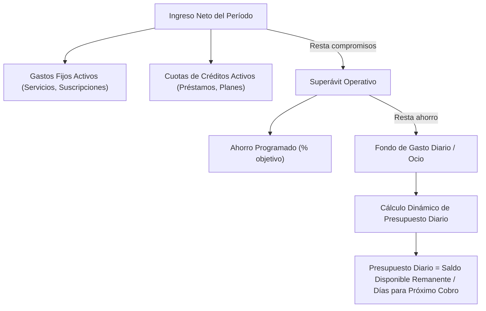
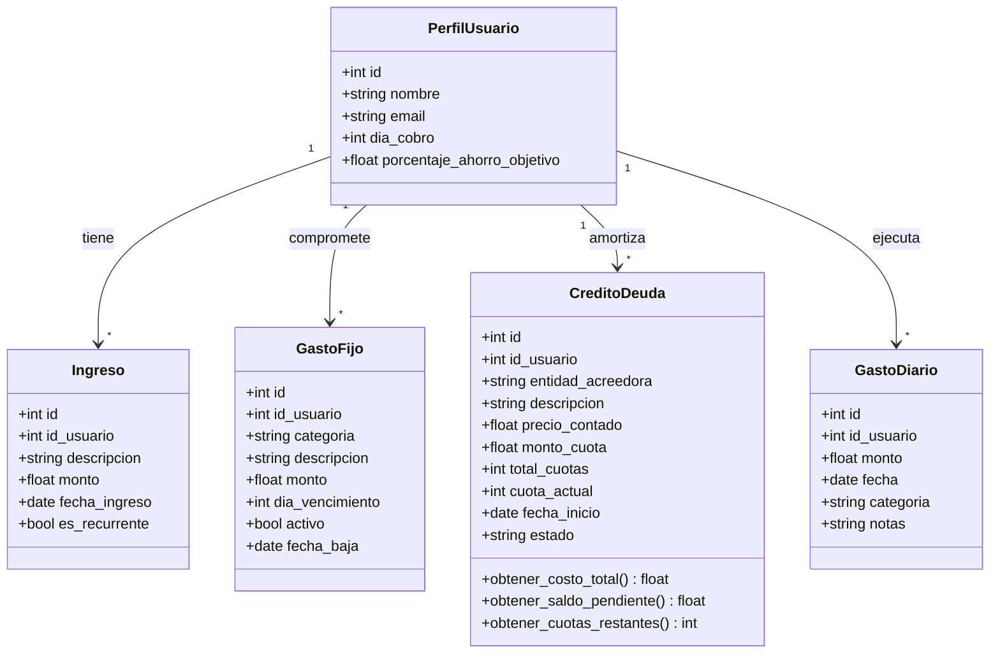

# Modelo de Dominio y Análisis Financiero - EFI Finanzas Personales

## 1. Visión Financiera del Negocio

El sistema gestiona el flujo de fondos según el ciclo real de ingresos del usuario (determinado por su día de cobro), descontando compromisos ineludibles y protegiendo el ahorro antes de definir el ritmo de gasto diario.

### Flujo de Transformación del Ingreso

---

## 2. Reglas de Negocio Incorporadas

> [!NOTE]
>
> ### 1. Ciclo Financiero Automatizado por Perfil
>
> - Cada usuario define su `dia_cobro` (ej. 15).
> - El período activo va desde el día `dia_cobro` del mes actual hasta el día `dia_cobro - 1` del mes siguiente.
> - Todos los cálculos de gastos acumulados y días restantes se sincronizan con este rango temporal.

> [!IMPORTANT]
>
> ### 2. Ciclo de Vida y Variación de Gastos Fijos
>
> - **Baja lógica (`activo: bool`, `fecha_baja: date`)**: Si el usuario cancela un servicio (ej. da de baja Netflix), el registro no se borra físicamente de la base de datos para no romper los balances históricos de los meses previos; simplemente deja de computarse para los ciclos posteriores a su baja.
> - **Ajuste por inflación (`monto` actualizable)**: El monto puede actualizarse conservando coherencia con los períodos vigentes.

> [!TIP]
>
> ### 3. Análisis Financiero de Créditos y Transición de Estados
>
> - **Costo Financiero Total (CFT)**: Si se ingresa el `precio_contado` y el plan de cuotas (`monto_cuota * total_cuotas`), el sistema calcula el sobrecosto real por financiamiento:
>   $$\text{Interés Total} = (\text{monto\_cuota} \times \text{total\_cuotas}) - \text{precio\_contado}$$
> - **Máquina de Estados de la Deuda**:
>   - Endpoint específico (ej. `POST /creditos/{id}/registrar-pago`) que valida que el crédito esté `activo` y `cuota_actual < total_cuotas`.
>   - Incremento atómico: `cuota_actual += 1`.
>   - **Disparador de Cancelación**: Al registrarse la cuota final (`cuota_actual == total_cuotas`), el estado muta automáticamente a `'finalizada'`.
>   - **Impacto en Flujo de Fondos**: A partir del siguiente ciclo de cobro, la cuota deja de computarse como compromiso obligatorio, liberando ese monto al saldo disponible diario y mejorando la capacidad de endeudamiento.

> [!TIP]
>
> ### 4. Motor de Proyección Temporal y Simulación (What-If)
>
> El simulador es un servicio de cálculo puro (sin persistencia en base de datos) que proyecta la evolución ciclo a ciclo:
>
> - **Entrada**: `monto_cuota_simulada`, `total_cuotas_simuladas`, `fecha_inicio_simulada`.
> - **Horizonte**: Proyecta mes a mes hasta la última cuota (tanto de créditos vigentes como del simulado).
> - **Cálculo por Ciclo**:
>   1. Discrimina deudas vigentes vs extinguidas en cada mes futuro (desendeudamiento progresivo).
>   2. Consolida: `Ingreso - Gastos Fijos - Cuotas Existentes Activas - Cuota Simulada - Ahorro`.
>   3. Devuelve: `presupuesto_diario_estimado` e `indice_endeudamiento_dti` para cada período futuro.
> - **Resultado**: Una serie temporal para graficar la evolución y ver cuándo repunta la liquidez diaria.

---

## 3. Modelo de Entidades (En Español)

### Detalle de Atributos y Responsabilidades

| Entidad             | Propósito Principal                                                                     | Campos Clave                                            |
| :------------------ | :-------------------------------------------------------------------------------------- | :------------------------------------------------------ |
| **`PerfilUsuario`** | Configuración base del ciclo financiero.                                                | `dia_cobro`, `porcentaje_ahorro_objetivo`               |
| **`Ingreso`**       | Fondos que ingresan al patrimonio.                                                      | `monto`, `fecha_ingreso`, `es_recurrente`               |
| **`GastoFijo`**     | Salidas continuas sin cuotas finitas. Permite bajas lógicas y actualización de precios. | `monto`, `dia_vencimiento`, `activo`, `fecha_baja`      |
| **`CreditoDeuda`**  | Compromisos con plazo definido, cálculo de costo financiero total y desendeudamiento.   | `monto_cuota`, `total_cuotas`, `cuota_actual`, `estado` |
| **`GastoDiario`**   | Consumos cotidianos que van mermando el fondo libre disponible del ciclo.               | `monto`, `fecha`, `categoria`                           |

---

### 4. Alineación con los Requisitos Técnicos de la Cátedra (EFI)

Para cumplir a rajatabla con el reglamento de la cátedra de Facundo Lemo:

1. **Estructura Modular**:
   - `src/main.py`: Instancia de FastAPI, configuración de CORS, paginación (`fastapi-pagination`) y registro de routers.
   - `src/database.py`: Conexión a SQLite mediante `create_engine` y sesiones de SQLModel.
   - `src/models/`: Cada archivo implementará la tríada obligatoria:
     - `...Base`: Atributos comunes con `Annotated`.
     - `...` (`table=True`): Modelo de base de datos con claves foráneas.
     - `...Public`: Schema de salida para la API.
     - `...Nested`: Schema con relaciones anidadas para lectura profunda.
   - `src/routers/`: Routers modulares con 5 operaciones CRUD mínimas por recurso (`create`, `get_all` paginado, `get_by_id` con 404 documentado, `update`, `delete`).
2. **Endpoints de Valor Agregado (Lógica de Negocio)**:
   - `POST /creditos/{id}/registrar-pago`: Avanza de cuota y gestiona la extinción de la deuda.
   - `POST /simulaciones/credito`: Motor What-If que proyecta la serie temporal de cuotas, desendeudamiento progresivo y presupuesto diario futuro.
   - `GET /metricas/ciclo-actual`: Devuelve el saldo disponible, días para el cobro y presupuesto diario dinámico.
3. **Migraciones con Alembic**: Versionado formal en `/alembic/versions/`.
